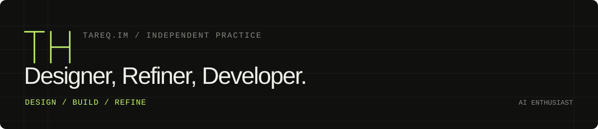

  

**Design / Build / Refine.** I shape ideas into clear identities and useful digital experiences, then refine the details that make them work.

I've worked across design and development since the 2000s. My practice moves between visual identity, interface design, accessibility, internationalization, and code. I’m also an AI enthusiast, exploring how intelligent tools can support thoughtful creative work.

## What I do

- **Brand** — identity systems, logos, and visual direction
- **Digital** — web design, UX, and product interfaces
- **Inclusive experiences** — accessibility (a11y) and internationalization (i18n)
- **Build** — turning designs into working, maintainable software
- **Explore** — practical, human-centered uses of AI

My work spans different tools and technologies, including PHP, Laravel, JavaScript, and MySQL. The problem and the people using the result come first.

## Featured work

### [SQL PowerTools](https://github.com/tareq-halaby/sql-powertools)

An open-source tool for safely cloning, sampling, exporting, and backing up MySQL databases. It includes sensitive-data masking and secure credential handling.

Open source is a meaningful part of how I work: I enjoy improving software with other people, from careful fixes and documentation to substantial feature work. In [WordCraft](https://github.com/storytold/wordcraft), I helped bring Arabic interface support and a mirrored right-to-left layout to the project ([merged pull request #5370](https://github.com/storytold/wordcraft/pull/5370)). In [PhotoCraft](https://github.com/storytold/photocraft), I added controls for OpenType numeral styles ([merged pull request #11051](https://github.com/storytold/photocraft/pull/11051)).

## Elsewhere

[Portfolio](https://tareq.im) · [Behance](https://www.behance.net/tareq_halaby) · [LinkedIn](https://linkedin.com/in/tareq-halaby) · [GitHub](https://github.com/tareq-halaby) · [X](https://twitter.com/tareq_halaby)

---

Designer, Refiner, Developer · Independent since the 2000s

